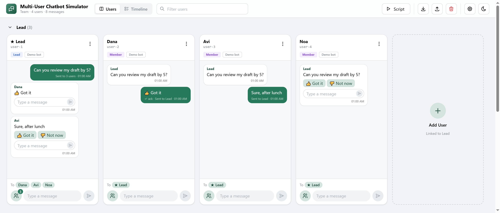

# Multi-User Chatbot Simulator

[](https://www.npmjs.com/package/multi-user-chatbot-simulator)
[](LICENSE)

Test a chatbot with many simulated users on one screen. Each user has their own chat; users are linked (a lead and their members, an agent and their customers), and one user's message can reach others through your bot.



- **Many users, side by side.** Type as anyone, tap the bot's buttons, answer each other.
- **Messages aimed at people.** Your bot gets `message.targets` and replies with `to`; each reply lands in the right chat, and the sender sees who it reached.
- **Your bot, your setup.** Connect through an HTTP JSON adapter (configured in the UI) or your own. Roles, relations and fields come from an editable profile.
- **Scripts.** Replay a scenario and check who got what, in the browser or headless in CI.
- **No backend.** Everything stays in the browser; export and import sessions as JSON.

## Install

```
npm install multi-user-chatbot-simulator react-router
```

```tsx
import { ChatbotSimulator, httpJson } from 'multi-user-chatbot-simulator';
import 'multi-user-chatbot-simulator/style.css';

<ChatbotSimulator profile="team" adapters={[httpJson({ type: 'bot', label: 'My bot' })]} />;
```

Without React, use the one-file build:

```html
<link rel="stylesheet" href="https://unpkg.com/multi-user-chatbot-simulator/dist/chatbot-sim.css" />
<div id="app" style="min-height: 100vh; display: flex; flex-direction: column"></div>
<script src="https://unpkg.com/multi-user-chatbot-simulator/dist/chatbot-sim.js"></script>
<script>
  ChatbotSim.mount(document.getElementById('app'), {
    profile: 'team',
    adapters: [ChatbotSimAdapters.httpJson({ type: 'bot', label: 'My bot' })],
  });
</script>
```

## Try the demo

```
git clone https://github.com/hananbenshabat/multi-user-chatbot-simulator.git
cd multi-user-chatbot-simulator
npm install
npm run dev
```

Open http://localhost:8765. It comes with a demo bot that runs in the browser, so nothing else is needed.

## Docs

- [Adapters](docs/adapters.md): connect your bot (messages, replies, polling, the HTTP JSON adapter)
- [Profiles](docs/profiles.md): IDs, roles, relations, fields, presets
- [Scripts](docs/scripts.md): scenarios with checks, recording, running in CI
- [API](docs/api.md): options, the controller, the export format
- [Server](docs/server.md) and [theming](docs/theming.md)

## License

[MIT](LICENSE)
