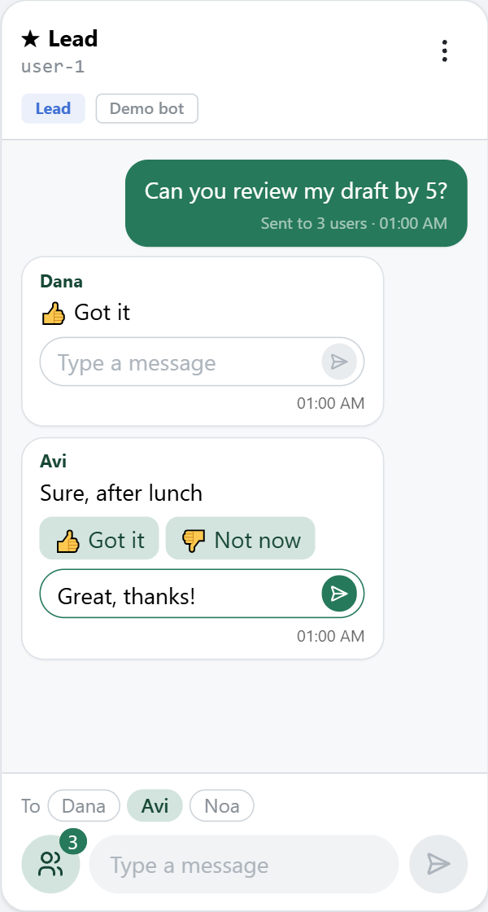
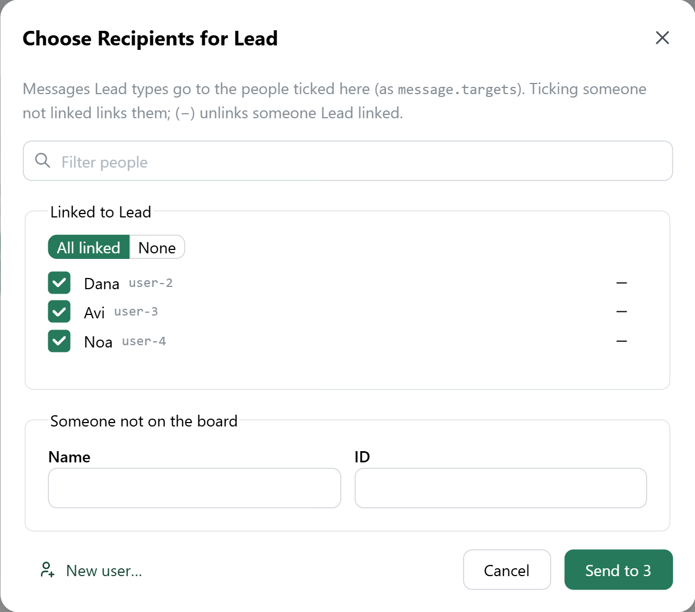
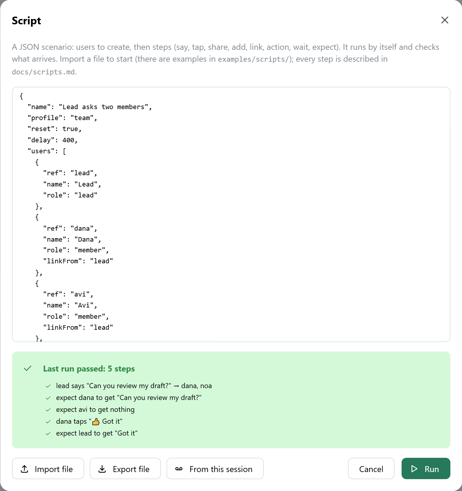
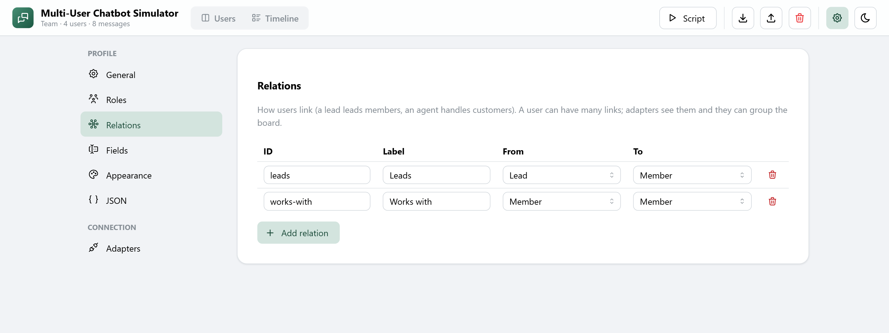
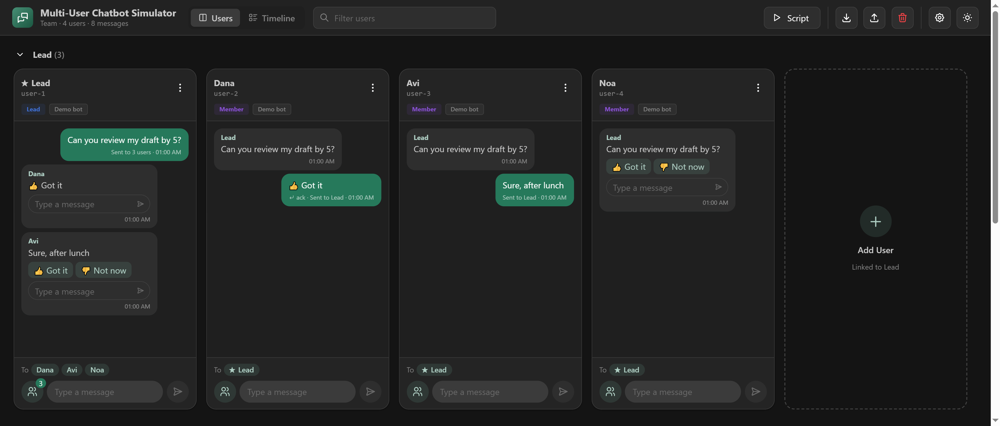

# Multi-User Chatbot Simulator

[](https://www.npmjs.com/package/multi-user-chatbot-simulator)
[](LICENSE)

**Simulate many users talking to your chatbot, and to each other through it.**

```
npm install multi-user-chatbot-simulator
```


Each *user* is a simulated person with their own chat. Create as many as you need, link them (a lead and their members, an agent and their customers, a teacher and their class…), type as any of them, tap the bot's buttons, answer each other, and watch every conversation side by side.

The core idea: **one user's message can reach others.** A lead sends one message; your API receives it plus the IDs it's aimed at (`message.targets`) and answers with replies addressed to those people (`"to": "…"`). Each reply lands in the right chat, with the sender's name on top, and the sent message says who it reached ("Sent to 3 users"). The same goes for anything your bot sends to other users on its own.

## How it works

<table>
  <tr>
    <td width="38%" valign="top">
      
    </td>
    <td valign="top">
      <b>Answer the person, not the room.</b> Messages relayed from other users show who they're from. Quick replies (👍 / 👎) sit under the message, with a reply box under the latest one from each person. Hovering or typing there highlights just that person in the <b>To</b> row, and the answer goes only to them. Once answered, the message keeps only the name and the text.
      <br><br>
      <b>The To row shows who you reach.</b> Everyone linked to this user, with the current recipients highlighted. A member's lead is always included.
      <br><br>
      
      <br>
      <b>Send to…</b> is the one place to change it: tick who gets your messages (ticking someone you aren't linked to links you), unlink with (−), or add a <b>New user…</b> linked to you.
    </td>
  </tr>
</table>

- **No backend, no database.** One script and one stylesheet drop into any page, or use it as a React component.
- **Any bot, any API.** Users talk to your bot through *adapters*: the built-in HTTP JSON adapter (configured in the UI), or a short adapter of your own.
- **Profiles make it yours.** One JSON file, editable in the UI, sets the ID format, roles, relations, custom fields, wording and look. Presets: Generic, Team, Support desk, Classroom, Phone numbers.
- **Scripts:** a JSON scenario (create users, say, tap, share, act, wait, expect) runs by itself and checks what arrives, from the toolbar or `app.run(script)`. Record what you did by hand into a script and replay it after every change.
- **Export/import** a whole session (profile, users, links, messages) as one JSON file, to share a scenario or attach it to a bug report.
- **Pages with their own URLs** ([React Router](https://reactrouter.com)): the board (`#/`), the timeline (`#/timeline`) and Settings (`#/settings/…`: the profile's General, Roles, Relations, Fields, Appearance and JSON, plus Adapters). Links and reloads keep you where you were.
- **A polished UI** (React + [Mantine](https://mantine.dev)) with day and night themes: it follows the system setting, with a toggle that remembers the viewer's choice.
- Buttons, lists, images, contacts and raw-data messages; adapter actions (reset test data, run a job…) that scripts and code can run; a timeline of all messages; bulk creation; filtering; right-to-left text; it works at phone width.

<table>
  <tr>
    <td width="50%"></td>
    <td width="50%"><br><br></td>
  </tr>
  <tr>
    <td>Scripts run a scenario and check who got what.</td>
    <td>Profiles define roles, relations, fields and looks; day and night themes.</td>
  </tr>
</table>

## Quick start

To try it with the built-in demo bot, run the demo page from this repo:

```
git clone https://github.com/hananbenshabat/multi-user-chatbot-simulator.git
cd multi-user-chatbot-simulator
npm install
npm run dev        # http://localhost:8765 (pages: /, /timeline, /settings/…)
```

The **Demo bot** runs in the browser:

1. Click the **Add User** tile to add a **Lead**, then use the **Add User** tile in the lead's group to add a few members.
2. Type as the lead: the message goes to everyone linked (the **To** row shows who). The **Send to…** button next to the message box picks other recipients and changes links.
3. A member gets the lead's message with 👍/👎 and a reply box under it; answering goes back to the lead only, and the message's reply controls go away.
4. **Script → Import file**, pick `examples/scripts/lead-asks-two-members.json`, then **Run**: it plays the whole scenario with checks.
   **Script → From this session** turns what you just did into a script.

To try a real server, run `npm run echo` (key `dev`). In **Settings** (the ⚙ icon) → **Adapters**, under **Local server**, set "Auth header value" to `dev`, the poll URL to `http://localhost:8000/poll` and the poll interval to `1`. Then add users with the **Local server** adapter.

Tests: `npm test`. Build: `npm run build`. Everything (types, lint, format, tests, dead code, build, package): `npm run check`.

## Use it in your project

```
npm install multi-user-chatbot-simulator react-router
```

React, React DOM and React Router are peer dependencies (your app's own copies are used); Mantine is bundled.

**Any page (no React needed):** use `dist/chatbot-sim.js` and `dist/chatbot-sim.css` from the package (React and Mantine are inside), for example from a CDN: `https://unpkg.com/multi-user-chatbot-simulator/dist/chatbot-sim.js` and `…/dist/chatbot-sim.css`.

```html
<link rel="stylesheet" href="chatbot-sim.css">
<div id="app" style="min-height: 100vh; display: flex; flex-direction: column"></div>
<script src="chatbot-sim.js"></script>
<script>
  const app = ChatbotSim.mount(document.getElementById('app'), {
    title: 'Bot console',
    storageKey: 'bot-console',  // autosave key in localStorage; null = keep nothing
    profile: 'team',            // a preset name or a profile object
    lockProfile: false,         // true: always use `profile` and hide the editor
    theme: 'auto',              // default theme before the viewer toggles: auto | light | dark
    adapters: [ChatbotSimAdapters.httpJson({ type: 'bot', label: 'My bot' })],
  });
</script>
```

**A React app** (React 19.2+, React Router 8+):

```tsx
import { ChatbotSimulator, httpJson } from 'multi-user-chatbot-simulator';
import 'multi-user-chatbot-simulator/style.css';

<ChatbotSimulator
  title="Bot console"
  profile="team"
  adapters={[httpJson({ type: 'bot', label: 'My bot' })]}
  onReady={(app) => { /* the controller: app.addUser(), app.send(), app.run(script)… */ }}
/>
```

Inside an app that already uses React Router, the simulator uses the app's router: mount it on a splat route, e.g. `<Route path="sim/*" element={<ChatbotSimulator … />} />`, and its pages live at `/sim`, `/sim/timeline` and `/sim/settings/…`. On its own it uses hash URLs (`#/settings/adapters`), which work on any static host; pass `routing: 'browser'` for clean paths (`/settings/adapters`) when your server sends every path to the page, or `routing: 'memory'` to leave the URL alone.

`examples/drop-in.html` is a complete page using the one-file build. Nothing is sent anywhere except to the URLs you configure in an adapter.

## Scripts

A script is a JSON scenario that creates users, acts as them (say, tap, share, link, run actions, wait) and checks who got what (`expect`). Use one to replay a flow after every change to your bot.

```json
{
  "name": "Lead asks two members",
  "profile": "team",
  "reset": true,
  "users": [
    { "ref": "lead", "name": "Lead", "role": "lead" },
    { "ref": "dana", "name": "Dana", "role": "member", "linkFrom": "lead" },
    { "ref": "avi", "name": "Avi", "role": "member", "linkFrom": "lead" }
  ],
  "steps": [
    { "as": "lead", "say": "Can you review my draft?", "to": ["dana"] },
    { "expect": { "user": "dana", "text": "Can you review my draft?" } },
    { "expect": { "user": "avi", "none": true } },
    { "as": "dana", "tap": "👍 Got it" },
    { "expect": { "user": "lead", "text": "Got it" } }
  ]
}
```

- **Import:** **Script → Import file** opens a `.json` script in the editor; press **Run**. Examples are in [`examples/scripts/`](examples/scripts).
- **Write or record:** the **Script** dialog edits JSON; **From this session** records what you did by hand, and **Export file** saves it to share or to import later.
- **From code or CI:** `await app.run(script)` in the browser, or headless in Node: `import { runScript } from 'multi-user-chatbot-simulator/script'` (with `/core` and `/adapters/http-json`, no React needed).

Every step and option is in [docs/scripts.md](docs/scripts.md).

## Documentation

| | |
|---|---|
| [docs/profiles.md](docs/profiles.md) | IDs, roles, relations, fields, wording, appearance, presets |
| [docs/adapters.md](docs/adapters.md) | The adapter contract, messages and replies, polling, actions, the HTTP JSON adapter, writing your own |
| [docs/scripts.md](docs/scripts.md) | JSON scenarios: steps, expectations, recording, running from code or CI |
| [docs/server.md](docs/server.md) | Adding a test endpoint to your bot so the console can drive it |
| [docs/theming.md](docs/theming.md) | Day/night theme, embedding in a page with its own theme, CSS tokens |
| [docs/api.md](docs/api.md) | `mount()` options, the controller, the export format |

## Files

| | |
|---|---|
| `src/core/` | the model: `profile.ts`, `session.ts`, `links.ts` (links and groups), `messages.ts` (replies and routing), `io.ts` (export/import), `template.ts` (no DOM, no dependencies; runs in Node) |
| `src/script/` | scripts: `parse.ts`, `run.ts`, `record.ts` (no DOM; runs in Node) |
| `src/adapters/` | `demo.ts` (in-browser demo bot, a template for your own), `http-json.ts` (configurable HTTP) |
| `src/ui/` | the React UI: `store.ts` (state, adapters, autosave, controller), the board, chats, dialogs, profile editor, `styles.css` |
| `src/types.ts` | TypeScript types for profiles, sessions, adapters and the controller |
| `src/index.ts`, `src/standalone.ts` | the React/ESM entry and the one-file build's entry |
| `demo/`, `index.html` | the demo page (`npm run dev`) |
| `examples/` | `echo-server.mjs` (reference server for the HTTP adapter), `drop-in.html`, `scripts/` (example scenarios to import) |
| `test/` | `npm test` (Vitest): logic tests in Node, UI tests in `test/ui/` with Testing Library |

## License

[MIT](LICENSE)
